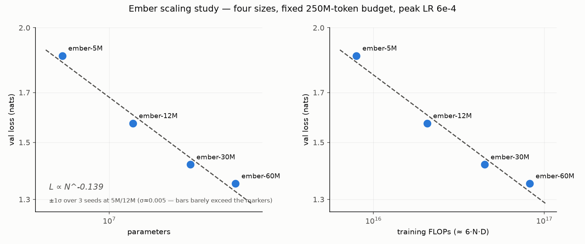

# Ember

A small GPT-class language model, forged end to end on a laptop GPU (RTX 3060 Laptop, 6GB).

Decoder-only transformer — pre-norm RMSNorm, RoPE, SwiGLU, no biases, weight-tied embeddings — trained from scratch on [TinyStories](https://huggingface.co/datasets/roneneldan/TinyStories) with a custom 8k-vocab BPE tokenizer. Four sizes (5M / 12M / 30M / 60M) for a scaling study; **ember-30M** is the hero: **val loss 1.2366 (ppl 3.44) on 600M tokens**, trained in ~5 hours on a 6GB laptop GPU.



Four sizes, one fixed 250M-token budget, identical batch/schedule/LR: **L ∝ N^−0.139**. The first pass of this plot had a kink in it — chasing it down with pre-registered predictions (it was the size-dependent LR recipe, worth ~0.2 nats) is the best story in [report/REPORT.md](report/REPORT.md).

Highlights beyond the plot: hand-rolled KV cache with token-exact equivalence tests (and an honest "when caching doesn't help" benchmark), a pre-registered LR sweep that caught and fixed a kink in the first version of the scaling curve — then bought the hero itself 0.09 nats — and a from-scratch LoRA (0.44% trainable, 534 KB adapter) that takes the instruct-format val loss from 2.24 to 1.45 and wins 86–90% of decisive blind LLM-judged matchups against its own base model (100 prompts, two independent judges, 83% verdict agreement, pinned judge config committed with every verdict).

Full details: [MODEL_CARD.md](MODEL_CARD.md) · [report/REPORT.md](report/REPORT.md) · [experiments/EXPERIMENT_LOG.md](experiments/EXPERIMENT_LOG.md) (every run, numbered).

## Quickstart

```bash
# venv with torch cu126, tokenizers, etc. assumed at .venv/
.venv/bin/python -m pytest -q                 # 39 fast CPU tests
.venv/bin/python scripts/prepare_data.py      # download + tokenize TinyStories
.venv/bin/python src/train.py --config configs/ember_30m_hero.py            # ~4-7h on a 3060
.venv/bin/python src/train.py --config configs/ember_30m_hero.py --resume   # after a crash
.venv/bin/python src/sample.py --ckpt checkpoints/ember_30m_hero/best.pt --prompt "Once upon a time"

bash scripts/reproduce.sh all   # or stage by stage: tests|data|ladder|hero|scaling|ablations|bench|lora|judge
```

## Layout

```
src/            model.py (RMSNorm/RoPE/SwiGLU + KV cache), train.py, sample.py, tokenizer.py, lora.py
configs/        one config per run: hero, scaling set, ablation axes, LoRA falsification runs
tests/          39 tests: shapes, causal-mask leak, param-count vs closed form, naive==SDPA,
                KV-cache equivalence, tokenizer round-trip, checkpoint io, LoRA identity/merge
experiments/    EXPERIMENT_LOG.md, per-run CSVs + loss curves, sample galleries, judge verdicts
scripts/        reproduce.sh, prepare_*.py, benchmark.py, judge_eval.py, plot_*.py, ladder scripts
report/         REPORT.md with embedded plots; scaling.png, benchmarks.png
```
