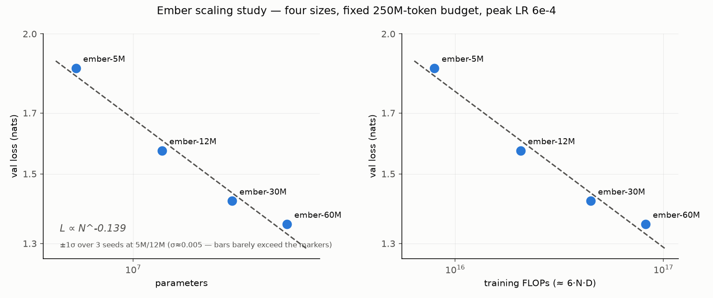
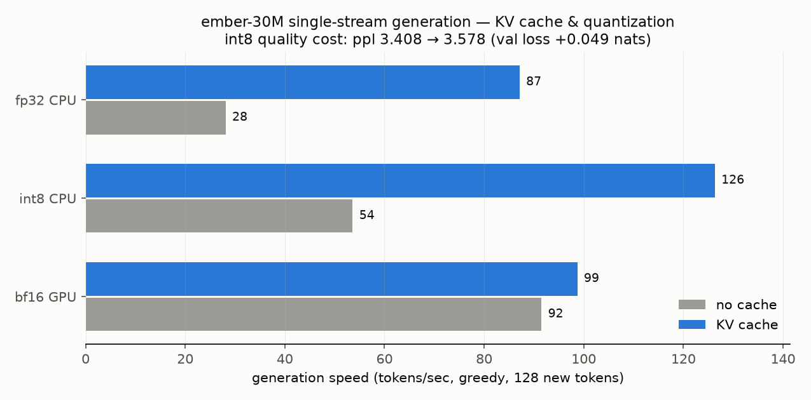

# Ember — technical report

*All plots regenerate from committed CSVs: `scripts/plot_loss.py`,
`scripts/plot_scaling.py`, `scripts/plot_benchmarks.py`. Every run is
numbered in `experiments/EXPERIMENT_LOG.md`; the full pipeline replays via
`scripts/reproduce.sh`.*

## 1. Setup

- Hardware: RTX 3060 Laptop 6GB (Ampere), WSL2 Ubuntu, Python 3.12, torch 2.12 cu126, bf16 autocast.
- Architecture: decoder-only transformer — pre-norm RMSNorm, RoPE, SwiGLU FFN, no biases, weight-tied embedding/unembedding, ctx 512.
- Tokenizer: byte-level BPE, vocab 8192, trained on TinyStoriesV2-GPT4 (subsampled every 4th story). 4.16 chars/token on the corpus.
- Data: TinyStoriesV2-GPT4 — 536.1M train / 5.4M val tokens, memmapped uint16. Val split is the dataset's own held-out valid file, produced before tokenization.

## 2. Sanity ladder

| Step | Gate | Result |
|---|---|---|
| 1. bigram | reaches empirical bigram entropy floor | 2.475 vs floor 2.453 nats |
| 2. overfit one batch | loss < 0.1 | 0.0007 @ 500 steps |
| 3. 5M char Shakespeare | recognizable English | PASS — best val 1.539; kill/`--resume` mid-run verified seamless |
| 4. 5M BPE TinyStories | coherent-ish sentences | PASS — story arcs with morals; val 1.754 after 60M tokens |
| 5. hero 30M | fluent stories | PASS — val 1.2366 (ppl 3.44); see gallery |

Samples for each gate live in `experiments/samples/`.

## 3. Hero run (ember-30M)

29.9M params, 600M tokens (~1.1 epochs of TinyStoriesV2), 2288 steps of
262k tokens, peak LR 6e-4 with 2% warmup + cosine decay, bf16, seed 1337.

- **Best val loss 1.2366 (perplexity 3.44)**, 5.24h wall clock.
- The LR matters at this schedule too: an otherwise-identical run at the
  standard size-based 3e-4 (which predated the §4 LR sweep) reached only
  1.3245 — retraining at the sweep-validated 6e-4 bought **0.088 nats**,
  confirming the sweep's finding transfers from the 953-step regime to the
  full 2288-step schedule.
- Thermal reality of laptop training, observed across runs: sustained load
  pins the GPU at its 88°C throttle target and wall clock stretches
  accordingly; checkpoints every 15 min + exact `--resume` (and WSL's
  freeze-on-sleep semantics) made every interruption a pause, not a loss.
- Loss curve: `experiments/runs/ember_30m_hero.png`. Fixed 30-prompt gallery:
  `experiments/samples/ember_30m_hero_gallery.md` (temperature 0.8, top-p 0.95).
- Qualitative: fluent grammatical stories with arcs, dialogue, and morals.
  Characteristic failure mode at this scale is referent confusion in
  multi-character scenes ("The squirrel showed the squirrel how to jump").

Pre-flight throughput finding worth keeping: at micro-batch 32×512 the peak
allocation (6.30GB) exceeds the 3060's 6.14GB, and CUDA-on-WSL silently spills
into shared system memory — throughput drops to 10.8k tok/s. Halving to
micro 16 × accum 32 (identical effective batch, 262k tokens/step) peaks at
3.43GB and runs 42.6k tok/s: a 4× speedup from *reducing* batch size. Lesson:
on WDDM, watch `max_memory_allocated` against physical VRAM, not just OOMs.

## 4. Scaling study (the flagship plot)

All four sizes trained to the same fixed **250M-token budget** with an
identical 262k-tokens/step batch, fully annealed cosine, and — after the LR
sweep below — a uniform **peak LR 6e-4**:

| model | params | tokens/param | final val |
|---|---|---|---|
| ember-5M | 5.3M | 47 | 1.8644 |
| ember-12M | 13.8M | 18 | 1.5737 |
| ember-30M | 29.9M | 8.4 | 1.4190 |
| ember-60M | 54.8M | 4.6 | **1.3530** |

Power-law fit: **L ∝ N^−0.139** (log-log, four points, monotonic).

**Seed variance, measured.** The 5M and 12M points were rerun with two
additional seeds (1338/1339): σ = 0.0050 and 0.0051 nats respectively,
range ≈ 0.010 at both sizes. The smallest gap between adjacent scaling
points (0.066 nats, 30M→60M) is ~13σ, so the ordering and fit are far
outside seed noise; the plot's error bars are smaller than its markers.
Larger sizes were not rerun — seed noise tends to shrink with scale, so
the small-model σ serves as a conservative bound.

**How the plot earned its shape — the LR sweep.** The first pass used the
standard size-dependent recipe (6e-4 for 5–12M, 3e-4 for 30–60M) and showed
a kink: 30M (1.5862) *worse* than 12M (1.5737), fit slope −0.093. Both
follow-up predictions were registered before running: 30M rerun at 6e-4
dropped to **1.4190** (predicted < 1.5737 ✓); the reverse check, 12M at
3e-4, rose to **1.7906** (predicted > 1.5862 ✓); 60M at 6e-4 dropped
1.4696 → **1.3530**, with no bf16 instability at any size. The halved LR
costs ~0.1–0.2 nats at this short 953-step regime — the kink was the
recipe, not the architecture. Lesson: at fixed short schedules, tune LR
per regime rather than trusting size-based folklore.

**Fixed-D comparisons still compress the scaling gap.** The 60M gets 4.6
tokens/param (Chinchilla-comfortable is ~20) and shows the expected slight
flattening at the right edge of the plot. Compute check at matched LR: the
60M spends ~0.8×10¹⁷ FLOPs and lands at 1.3530, while the hero-30M spent
~1.1×10¹⁷ at a near-optimal 20 tokens/param and reached **1.2366** — 1.35×
the compute buying 0.12 nats, with allocation doing much of the work.
Params and data must co-scale; allocation, not just scale, sets the
frontier.

**Batch-size ablation (prediction confirmed).** At the 262k giant batch, the
5M model scored *worse* with 250M tokens (1.864) than it had with 60M tokens
at a 16k batch (1.754, ladder 4). The pre-registered falsification run
(`configs/ablate_5m_smallbatch.py`, prediction "val < 1.754" committed
before execution) rerun the same 5M / 250M tokens / same LR with the 16k
batch: **val 1.4856** — a 0.38-nat improvement purely from taking 15,258
optimizer steps instead of 953. Two consequences worth stating plainly:

- The training code is vindicated; the anomaly was critical-batch-size
  economics, not a bug.
- The scaling study's shared 262k batch — chosen so the four points are
  comparable — handicaps the small end hardest (the small-batch 5M nearly
  matches the giant-batch 60M: 1.4856 vs 1.4696). The *relative* ordering
  stands, but the absolute numbers are regime-specific. Since batch size
  doesn't change total FLOPs, a v2 of the study at a 16k batch would cost
  the same GPU-hours and is the obvious next refinement.

## 5. Ablations — is the modern stack actually better?

Six runs at 12M scale, 100M tokens each, 16k tokens/step, peak LR 6e-4,
seed 1337; each variant departs from the baseline in exactly one axis
(configs/ablation_12m_*.py):

| variant | val loss | Δ | reading |
|---|---|---|---|
| **baseline** (RoPE, pre-RMSNorm, SwiGLU, 6×384) | **1.4525** | — | |
| LayerNorm (bias-free) | 1.4527 | +0.000 | dead tie — RMSNorm's win is compute, not loss |
| deep-narrow (12×272, param-matched) | 1.4618 | +0.009 | width edges depth at this scale, and deep is 1.6× slower wall-clock (2× layers = 2× sequential launches) |
| GELU MLP (param-matched, 1.5× hidden) | 1.4659 | +0.013 | SwiGLU's "consistent small gain," reproduced |
| learned positions | 1.4748 | +0.022 | RoPE better, with zero learned params |
| post-norm | 1.4904 | +0.038 | worse but *stable* at 6 layers — the historical divergence story needs depth to bite |

Every choice in the Ember stack either wins its axis or ties it. The two
practical notes: RMSNorm should be defended on efficiency (the quality
claim doesn't survive measurement), and depth costs real wall-clock
throughput beyond its small quality deficit.

## 6. Inference engineering (M3)

**KV cache, by hand.** Per-layer preallocated K/V buffers, RoPE offset by
cache position, three attention regimes (prefill `is_causal`, single-token
decode, offset-masked chunked append). Correctness is tested, not assumed:
cached greedy decoding equals the recompute path token-for-token, stepwise
logits match a full forward to 1e-4 on both attention impls, and the
measured cache size (8.39 MB for ember-30M at ctx 512, bf16) matches the
closed-form `2 · layers · heads · head_dim · ctx · 2B` exactly.

**Results** (greedy, 128 new tokens, single stream):

| variant | no cache | KV cache | speedup |
|---|---|---|---|
| fp32 CPU | 28 tok/s | 87 tok/s | 3.1× |
| int8 CPU (torch.ao dynamic) | 54 tok/s | 126 tok/s | 2.4× |
| bf16 GPU (RTX 3060 L) | 92 tok/s | 99 tok/s | **1.1×** |

Three findings worth defending:

1. **The KV cache pays where compute dominates** — 2.4–3.1× on CPU.
2. **On the GPU it's a wash at this scale** (0.9–1.1× across reruns): a 30M
   model at ctx ≤ 512 is kernel-launch-latency-bound, so shrinking the
   matmuls barely matters and cache bookkeeping eats the rest. "When does a
   KV cache *not* help" is as instructive as when it does; at larger
   ctx/model/batch the crossover flips decisively.
3. **int8 + KV cache on CPU (126 tok/s) beats bf16 on the GPU (99 tok/s)**
   for single-stream decoding — quantization cost: val loss +0.049 nats
   (ppl 3.41 → 3.58, ~5%; a sharper model pays a visibly larger int8 tax
   than the earlier 3e-4 checkpoint's ~2%).

Sampling behavior across temperature/top-k/top-p:
`experiments/samples/ember_30m_hero_sampling_table.md` (greedy loops; T=1.3
degrades into incoherence; T≈0.8 with top-p 0.95 is the sweet spot).

## 7. Fine-tuning: LoRA from scratch (M4)

Rank-8 adapters on the frozen hero's wq/wv (`src/lora.py`, built from the
ΔW = B·A math up): **131,072 trainable params — 0.44% of the model — in a
534 KB adapter file**, trained 20 minutes on 40M TinyStories-Instruct
tokens. B is zero-initialized, so step 0 is exactly the base model (tested,
along with the 2·r·d count, frozen-base bit-exactness, and merge
equivalence).

| metric (val loss) | base hero | LoRA-tuned | Δ |
|---|---|---|---|
| instruct format | 2.2366 | **1.4473** | **−0.79** |
| pretrain stories | 1.2366 | 1.3265 | +0.09 (the specialization tax) |

**LLM-judge win rate** (100 held-out instruct prompts, blind, A/B order
randomized per prompt, per-verdict JSON with token accounting committed
under `experiments/judge/`): each prompt's identical seeded generations
were scored independently by **two judge models** as a robustness check.
The judge decoding config is pinned and recorded in each summary
(temperature 0, JSON mode, thinking disabled, capped output) — no
server-side defaults, so the eval is reproducible for a few cents.

| judge | LoRA / base / tie | LoRA share of decisive |
|---|---|---|
| gemini-2.5-flash | **86 / 10 / 4** | 90% (95% CI 82–94%) |
| gemini-2.5-flash-lite | **86 / 14 / 0** | 86% (95% CI 78–91%) |

Cross-judge winner agreement: **83/100 exact**. Rubric means improve on
all four dimensions under both judges. Instruction-following stays modest
in absolute terms — a 30M model follows the format and the prompt's gist,
not every constraint. The loss deltas above are the primary quantitative
evidence; the judges corroborate them.

## 8. Limitations

- **Domain**: TinyStories is synthetic and narrow; fluency here does not
  transfer to general text, and no general-benchmark evaluation was run.
- **Dedup**: TinyStoriesV2 is used as published; no additional dedup between
  train and valid beyond the dataset's own split. Quantifying n-gram overlap
  is a prerequisite for any generalization claim.
- **Seed noise (now measured)**: the headline runs use seed 1337; a 3-seed
  study at 5M/12M measured σ ≈ 0.005 nats (§4). Deltas below ~0.01 nats
  (e.g. the LayerNorm "tie") are within noise and should be read as ties;
  the scaling ordering sits ~13σ clear. 30M+ runs remain single-seed.
- **Batch regime**: the scaling study's shared 262k-token batch handicaps
  the small end (measured: −0.38 nats for the 5M at a 16k batch, §4).
  Relative ordering stands; absolute numbers are regime-specific.
- **Judge eval**: two same-family (Gemini) judges; n=100 gives ~±8%
  confidence intervals; instruction-following rubric scores are low in
  absolute terms. Loss deltas, not judge scores, carry the primary claim.
- **Inference benchmarks** are single-stream, batch-1, greedy at ctx ≤ 512
  on one specific laptop; the GPU KV-cache "wash" finding does not
  generalize to longer contexts, larger models, or batched serving.
- **LoRA variant** trades +0.10 nats of story quality for the instruct
  format; it follows format and gist, not fine-grained constraints.
